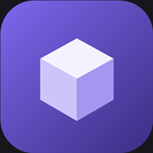
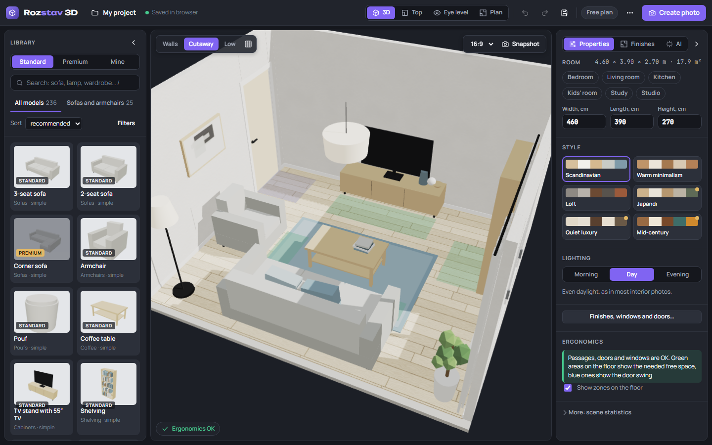
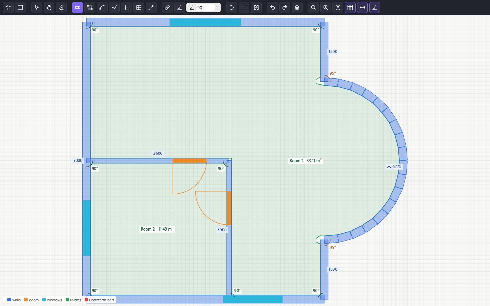
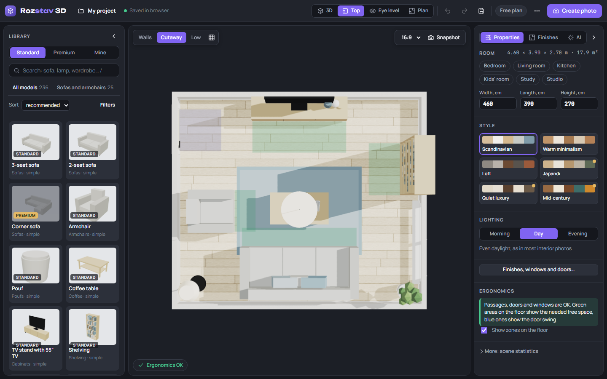
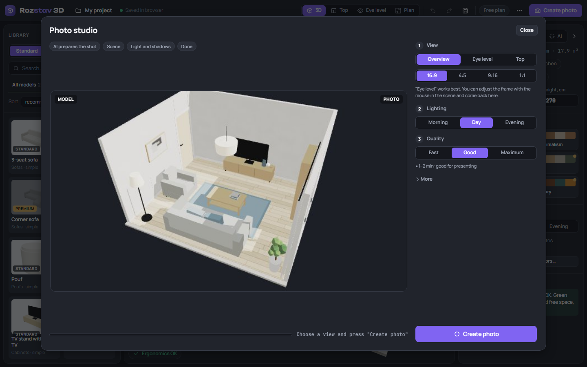
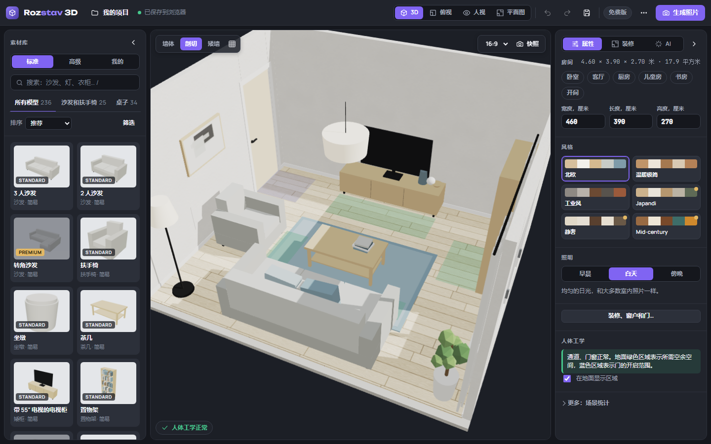
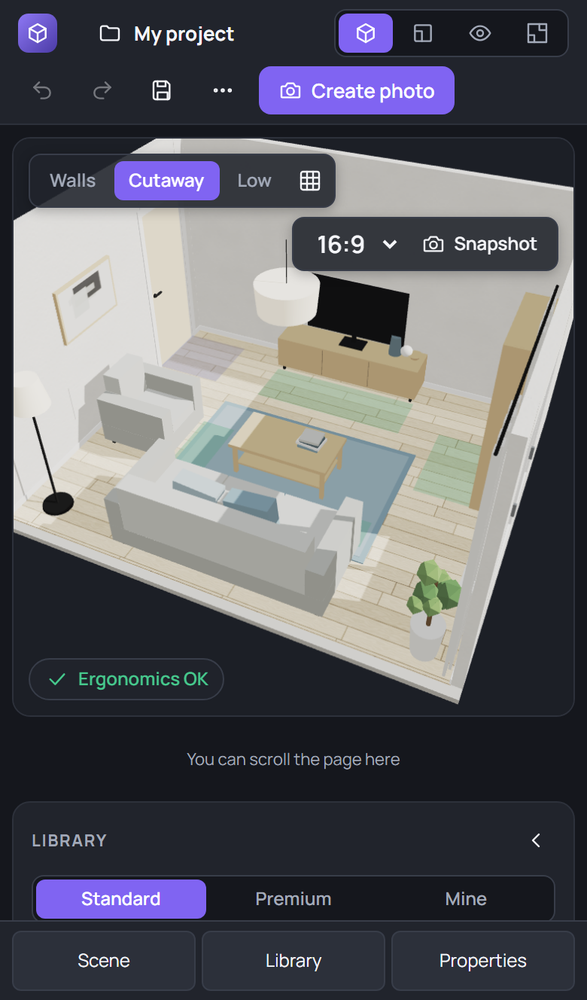

# Rozstav 3D

**Plan a room in 3D right in your browser: draw it, furnish it, take a realistic photo of it.**

No sign-up. No installation. Your plans stay on your device.

### [▶ Open the app](https://romkaua.github.io/rozstav3d/)

**English** · [Українська](README.uk.md)

## What you can do

| | |
|---|---|
| 🏠 **Draw a floor plan** | Walls, rectangles, curved and freeform walls, doors, windows and stairs, all in millimeters. Corners snap to 90° or to any angle you set. |
| 📐 **Start from a drawing** | Open a PNG, JPEG, WebP, SVG or DXF plan. Walls, openings and rooms are detected on your device, and you review them before anything is built. |
| 🛋️ **Furnish it** | 236 items, including 111 realistic CC0 models. Drag them in, rotate them, change their size, or add your own `.glb` models. |
| 🎨 **Finish it** | Floor coverings, wall paint, wallpaper, tile, skirting boards, cornices, niches, windows and doors, with your own textures if you want them. |
| 📏 **Check the ergonomics** | The app warns you when a passage is too narrow, furniture overlaps or something blocks a door. |
| 📷 **Create a photo** | Path tracing on your own graphics card gives you soft shadows, bounced light and sun through the windows. It is free. |
| 📦 **Take it further** | Export a GLB model, a DXF drawing, or a project file you can move to another device. |

## Screenshots

<table>
<tr>
<td width="50%"> <b>Plan editor.</b> Full screen, icon toolbar, angles and lengths on the plan.</td>
<td width="50%"> <b>Top view.</b> Arrange the furniture with the whole room in sight.</td>
</tr>
<tr>
<td width="50%"> <b>Photo studio.</b> Choose the view, the light and the quality.</td>
<td width="50%"> <b>Three languages.</b> English, Ukrainian and Chinese.</td>
</tr>
</table>

 <b>On a phone.</b> Touch gestures and a section bar.

## Getting started

1. **[Open the app](https://romkaua.github.io/rozstav3d/).** It picks your browser's language; you can change it under **⋯ → Language**.
2. **Choose a room** in the wizard, or use **⋯ → Draw a plan by hand**.
3. **Drag furniture** from the library into the room.
4. **Press "Create photo"** and pick a view and light.

To keep it on your phone, add it to your home screen. On iPhone: Safari → Share → Add to Home Screen. On Android: browser menu → Install.

### Touch gestures

| Gesture | Action |
|---|---|
| Pinch | Zoom in and out |
| Two fingers | Move the scene |
| One finger | Rotate the scene, even when it starts on furniture |
| One finger in Top view | Move the plan |
| Tap an item | Select it |
| Drag a selected item | Move it |
| Second finger during a drag | Put the item back and control the camera |

## Your plans stay yours

- Plans and projects are processed **in your browser** and are not uploaded anywhere.
- There are no accounts, and the app has no analytics code.
- The only outside request is for fonts from Google Fonts. Offline, the app uses system fonts.

Projects live in your browser's storage on that device. Use **Projects → Export** to keep a copy or move it to another device, because browsers can clear their stored data.

## Web version and Windows app

The online version is the one published here. A separate Windows app exists with a few extras.

| Feature | Online | Windows app |
|---|---|---|
| Plan editor, 3D scene, furniture, photo | ✅ | ✅ |
| Open plans from images, SVG, DXF | ✅ | ✅ |
| Own `.glb` models | ✅ in this browser | ✅ |
| Open plans from PDF | ❌ | ✅ |
| Open and save DWG | ❌ use DXF | ✅ with the free ODA File Converter |
| Export to 3ds Max (FBX + MAXScript) | ✅ | ✅ plus a texture folder |
| AI assistant (your own Gemini or OpenAI key) | ❌ | ✅ |

## Good to know

- **Browser support.** You need a browser with WebGL 2: a recent Chrome, Edge or Safari. The automated tests cover Chromium and WebKit, including phone profiles. Firefox has not been tested.
- **Devices.** Speed on phones depends on the device, and the path-traced photo is demanding.
- **Curved walls** are built from short straight segments, and doors and windows can only go on straight walls for now.
- **Translations** were not reviewed by native speakers. If a phrase reads oddly, please open an issue.

## Technology

Plain HTML and JavaScript with [three.js](https://threejs.org) and [three-gpu-pathtracer](https://github.com/gkjohnson/three-gpu-pathtracer). There is no backend: this repository is the built site, served by GitHub Pages.

## Credits and licensing

- Furniture models: [Poly Haven](https://polyhaven.com), [CC0](https://creativecommons.org/publicdomain/zero/1.0/).
- 3D engine: three.js and three-gpu-pathtracer, MIT.
- The app itself has no open-source license: you are welcome to use the site, but its code is not licensed for reuse.
