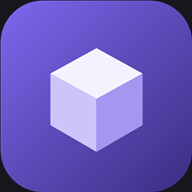
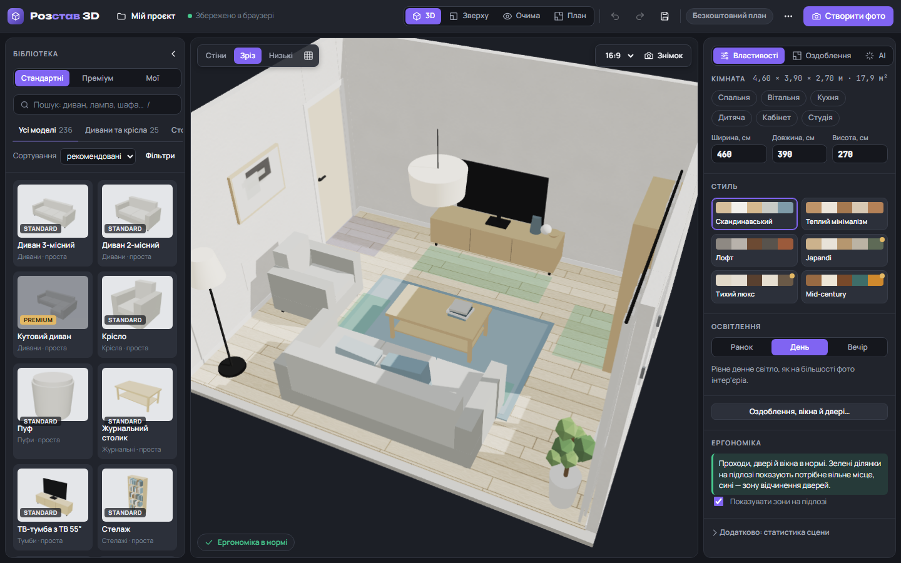
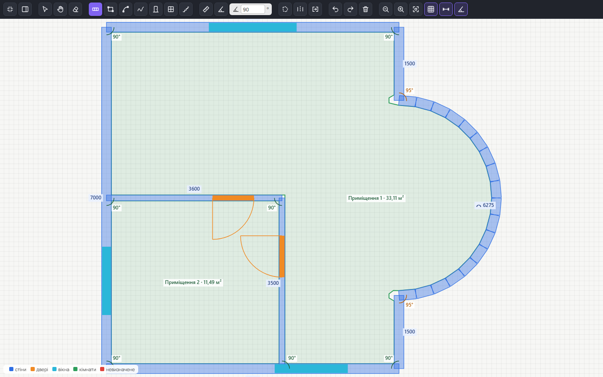
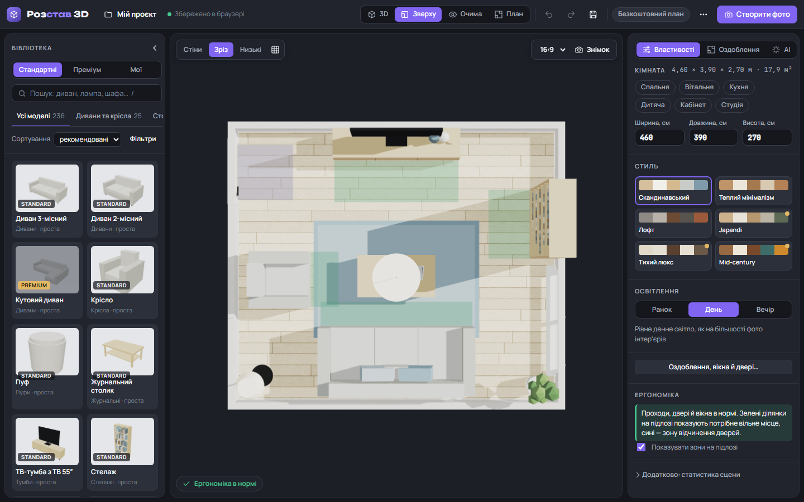
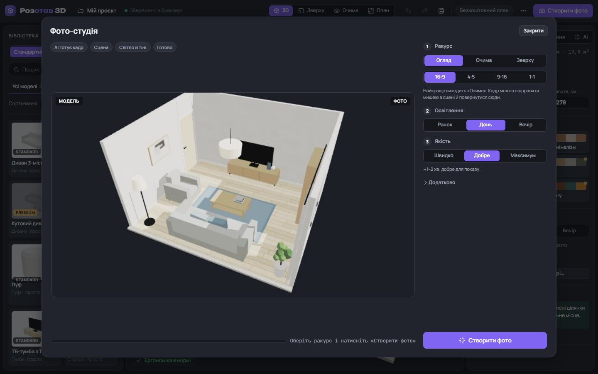
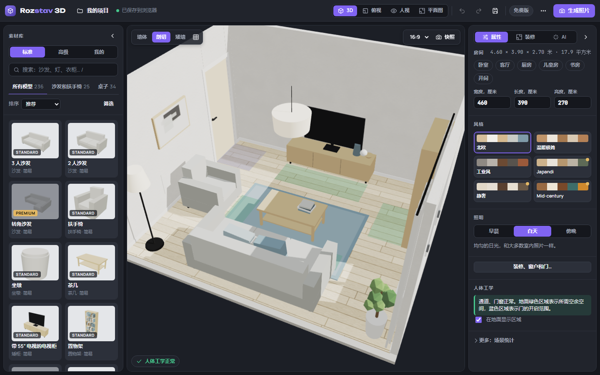
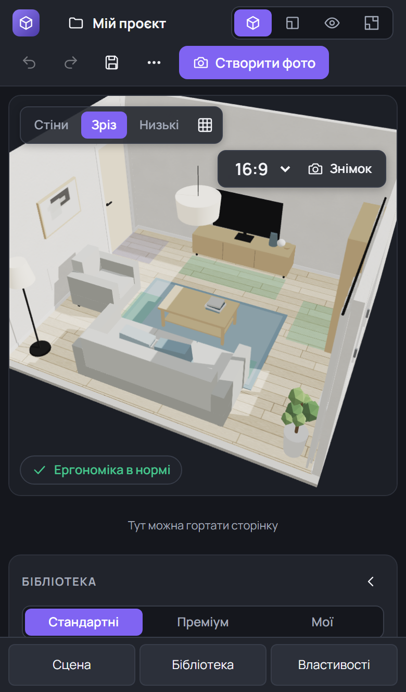

# Розстав 3D

**Плануйте кімнату в 3D просто в браузері: намалюйте, обставте меблями, зробіть реалістичне фото.**

Без реєстрації. Без встановлення. Ваші плани лишаються на вашому пристрої.

### [▶ Відкрити програму](https://romkaua.github.io/rozstav3d/)

[English](README.md) · **Українська**

## Що можна робити

| | |
|---|---|
| 🏠 **Намалювати план** | Стіни, прямокутники, заокруглені й довільні стіни, двері, вікна та сходи, усе в міліметрах. Кути прив'язуються до 90° або до будь-якого заданого значення. |
| 📐 **Почати з креслення** | Відкрийте план у форматі PNG, JPEG, WebP, SVG чи DXF. Стіни, прорізи й кімнати розпізнаються на вашому пристрої, і ви перевіряєте їх перед побудовою. |
| 🛋️ **Обставити** | 236 предметів, серед них 111 реалістичних моделей CC0. Перетягуйте їх, повертайте, змінюйте розмір або додавайте власні моделі `.glb`. |
| 🎨 **Оздобити** | Підлога, фарба, шпалери, плитка, плінтуси, карнизи, ніші, вікна й двері, за бажання з власними текстурами. |
| 📏 **Перевірити ергономіку** | Програма попередить, якщо прохід завузький, меблі накладаються або щось заважає дверям. |
| 📷 **Створити фото** | Трасування променів на вашій відеокарті дає м'які тіні, відбите світло й сонце крізь вікна. Це безкоштовно. |
| 📦 **Працювати далі** | Експортуйте модель GLB, креслення DXF або файл проєкту, який можна перенести на інший пристрій. |

## Скриншоти

<table>
<tr>
<td width="50%"> <b>Редактор плану.</b> Повний екран, панель значків, кути й довжини на плані.</td>
<td width="50%"> <b>Вигляд зверху.</b> Розставляйте меблі, бачачи всю кімнату.</td>
</tr>
<tr>
<td width="50%"> <b>Фото-студія.</b> Оберіть ракурс, світло та якість.</td>
<td width="50%"> <b>Три мови.</b> Українська, англійська й китайська.</td>
</tr>
</table>

 <b>На телефоні.</b> Жести й панель розділів.

## Як почати

1. **[Відкрийте програму](https://romkaua.github.io/rozstav3d/).** Вона бере мову браузера; змінити її можна в меню **⋯ → Мова**.
2. **Оберіть кімнату** в майстрі або скористайтеся пунктом **⋯ → Намалювати план вручну**.
3. **Перетягніть меблі** з бібліотеки в кімнату.
4. **Натисніть «Створити фото»** й оберіть ракурс і світло.

Щоб тримати програму на телефоні, додайте її на головний екран. На iPhone: Safari → «Поділитися» → «На екран "Додому"». На Android: меню браузера → «Встановити».

### Жести на сенсорному екрані

| Жест | Дія |
|---|---|
| Щипок | Наблизити чи віддалити |
| Два пальці | Пересунути сцену |
| Один палець | Обернути сцену, навіть якщо він торкнувся меблів |
| Один палець у вигляді «Зверху» | Пересунути план |
| Дотик до предмета | Вибрати його |
| Перетягування вибраного предмета | Перемістити його |
| Другий палець під час перетягування | Повернути предмет на місце й керувати камерою |

## Ваші плани лишаються вашими

- Плани й проєкти обробляються **у вашому браузері** й нікуди не завантажуються.
- Облікових записів немає, коду аналітики в програмі теж.
- Єдиний зовнішній запит — шрифти з Google Fonts. Без інтернету програма бере системні шрифти.

Проєкти зберігаються у сховищі браузера на цьому пристрої. Щоб мати копію або перенести проєкт на інший пристрій, скористайтеся **«Проєкти → Експорт»**, бо браузери можуть очищати збережені дані.

## Онлайн-версія і програма для Windows

Тут опубліковано онлайн-версію. Є й окрема програма для Windows з кількома додатковими можливостями.

| Можливість | Онлайн | Програма для Windows |
|---|---|---|
| Редактор плану, 3D-сцена, меблі, фото | ✅ | ✅ |
| Відкриття планів із зображень, SVG, DXF | ✅ | ✅ |
| Власні моделі `.glb` | ✅ у цьому браузері | ✅ |
| Відкриття планів із PDF | ❌ | ✅ |
| Відкриття й збереження DWG | ❌ використовуйте DXF | ✅ з безкоштовним ODA File Converter |
| Експорт у 3ds Max (FBX + MAXScript) | ✅ | ✅ і тека текстур |
| AI-помічник (ваш ключ Gemini чи OpenAI) | ❌ | ✅ |

## Що варто знати

- **Браузери.** Потрібен браузер із WebGL 2: сучасний Chrome, Edge або Safari. Автоматичні тести охоплюють Chromium і WebKit, зокрема профілі телефонів. Firefox не перевірявся.
- **Пристрої.** Швидкість на телефоні залежить від моделі, а фото з трасуванням вимагає чимало ресурсів.
- **Заокруглені стіни** складаються з коротких прямих сегментів, а двері й вікна поки що ставляться лише на прямі стіни.
- **Переклади** не перевіряли носії мов. Якщо якась фраза звучить дивно, створіть, будь ласка, issue.

## Технології

Звичайні HTML і JavaScript із [three.js](https://threejs.org) та [three-gpu-pathtracer](https://github.com/gkjohnson/three-gpu-pathtracer). Серверної частини немає: цей репозиторій містить готовий сайт, який віддає GitHub Pages.

## Авторство й ліцензії

- Моделі меблів: [Poly Haven](https://polyhaven.com), [CC0](https://creativecommons.org/publicdomain/zero/1.0/).
- 3D-рушій: three.js і three-gpu-pathtracer, MIT.
- Сама програма не має відкритої ліцензії: сайтом можна користуватися, але код не ліцензовано для повторного використання.
